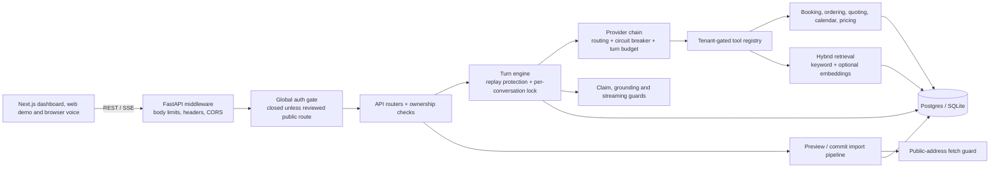

# Recepto — AI receptionist platform

> Planned product rename: **helloWick**. This write-up uses Recepto because that is the name in the current source and public demo.

**Live:** [receptio-v3.vercel.app](https://receptio-v3.vercel.app) (free-tier demo; a cold start can take a minute)

## 1. Summary

Recepto is a multi-tenant AI receptionist for small service businesses. Each business configures an agent with its services, opening hours, prices and documents. The agent can answer questions, propose and confirm appointments, take orders or messages, and escalate—while recording conversations, tasks and a receipt of the checks performed.

The implementation is a FastAPI service over Postgres/SQLAlchemy with a Next.js dashboard. Its central design choice is that the model can interpret a caller's intent, but deterministic code decides what changes: availability, totals, consent, writes and evidence-backed claims.

**Status:** working demo, not production-ready. It runs on free hosting (Render, Neon Postgres and Vercel). Authentication, ownership enforcement, request idempotency and transport hardening exist; calendar-backed booking, password recovery, roles and a distributed rate limiter remain future work.

## 2. Problem and constraints

A conventional chat bot can absorb routine questions. It becomes risky when it tells a customer a wrong price, announces a booking that did not commit, or turns unreliable source material into confident facts. The system treats generated output as untrusted.

- **Free runtime only.** Provider legs can rate-limit, time out, return an empty completion or disappear without notice.
- **Weak models need deterministic boundaries.** Tools compute dates, capacity and money; a model is never the source of truth for them.
- **Free hosts are ephemeral.** PostgreSQL, rather than local disk, holds the durable state.
- **Multi-tenant by design.** A forgotten ownership check must fail closed rather than expose another business's data.
- **English only, deliberately.** This keeps prompts, testing and the initial product scope tractable.

## 3. Architecture



### One conversation turn

1. Middleware rejects oversized input; the global auth gate and ownership dependency admit only the current user or a deliberately public demo route. A request id and input hash make retries replay safe rather than execute a second time.
2. The turn engine takes a per-conversation lock, prepares caller context and agent configuration, and handles crisis or total-provider-outage paths without a model call.
3. The model may choose only tools enabled for that tenant. Code checks availability, calculates prices, records proposals and is the only layer allowed to confirm a state-changing action.
4. The provider client tries an ordered free-tier chain. Failing or slow legs are temporarily benched, and every attempt is capped by both a per-call deadline and the remaining budget for the whole turn.
5. The draft is screened for ungrounded money or contact information, false action claims, undocumented denials and internal-tool leakage. A bad candidate receives one private repair prompt; an unresolved unsafe claim is replaced, not merely annotated.
6. The final reply, action receipt and bounded diagnostic trace are persisted. Streaming holds sentences that could announce an unverified action until the final checks pass.

## 4. Integrations and failure handling

| Integration | What can fail | Containment |
|---|---|---|
| Groq, Gemini and compatible LLM endpoints | 429s, retired models, timeouts, empty replies | One client path; difficulty-aware routing; 45-second circuit-breaker cooldown; each request has a deadline |
| Gemini embeddings | quota, network errors, model changes | Embedding returns no vector and retrieval falls back to keyword search |
| User-supplied website and Jina reader fallback | blocked/JS-only pages, malicious or internal addresses | Resolve and vet the address at connect time, validate redirects, cap reads at 5 MB, retry boundedly |
| Nominatim, postcodes.io and UK bank-holiday APIs | availability and fair-use limits | Cache success and failure; an unavailable lookup means asking the caller rather than guessing |
| Browser voice | speech-recognition/TTS quality and interrupted streaming | The same turn engine supplies text; claim-bearing sentences are buffered before speech |

The provider client disables SDK-level retries. Those retries can hide a 429 from the breaker and make a simple question appear to hang. When every healthy leg is exhausted, the system returns an honest fallback or lead-capture path rather than inventing a result.

## 5. Data model

- **`User → Organization → Agent`.** The organization has an owner; an ownerless organization is unreachable by default. Agent settings are JSON but patched only through allow-listed groups.
- **`Service`, `Resource` and availability data.** Structured catalog and capacity records let a booking or quoted price refer to something that actually exists.
- **`Conversation` and `ConversationTurn`.** Conversation memory preserves known facts as older transcript is trimmed. A turn's request id and content hash prevent retrying a write after an interrupted request.
- **`Task` and `Receipt`.** Typed tasks model bookings, orders, messages and escalations. Receipts retain sources, guard verdicts and executed tools independently from a transcript that may later be purged.
- **`KnowledgeDoc`, `Embedding` and `DocQuestion`.** Retrieval data is separate from operational records. Embedding variants record the model configuration, so incomparable vectors are not mixed.

Schema changes are currently additive (`create_all` plus a small hand-written `ALTER TABLE` list); migration tooling is a known gap.

## 6. Design decisions

### Generated text is replaceable; recorded actions are authoritative

**Alternatives considered:** prompt-only rules, advisory warning labels, a model grading another model.

The original tests found replies that named real individual prices but invented a total. Leaving the reply in place with a warning would still mislead a caller, so grounding failures replace the wording. The trade-off is incomplete coverage: money, contacts, names and action claims are tightly checked, while broader policy prose is strictly grounded only for tenants that opt into strict mode.

### Confirming a booking is a code workflow, not a phrase

`book_appointment` creates a proposal. A caller's later answer is classified, then the service revalidates availability and writes the booking under a per-business lock. Postgres also takes an advisory transaction lock where available. A matching repeat confirmation is a no-op.

This separates "the model said booked" from "a durable task exists". It costs a little extra state and code, but prevents the most damaging class of receptionist failure: a confident nonexistent booking.

### One global access gate, not a convention on routes

Every route is closed unless it appears on a reviewed public list. Child resources are resolved through their agent and organization; another user's resource returns 404 rather than confirming it exists. Structural tests derive the route inventory from the app's OpenAPI description, so a newly added handler cannot quietly ship anonymous.

### Preview, then commit imports

JSON, CSV, PDFs and websites are parsed into a read-only preview first. Commit is idempotent by normalized name/title, runs in one transaction, and retains a model-drafted price only where the source contains that figure. It does not yet prove that the price was paired with the right service—that remains an explicit limitation.

## 7. A data-quality bug and its regression test

**Situation.** A strict-mode test involving a chunked PDF passed or failed depending on unrelated digits in the source text.

**Cause.** The money pattern stopped at a thousands separator, so `£9,999` became `£9`; the grounding check then found that stray `9` somewhere in the evidence and treated an invented four-figure price as supported.

**Fix.** The number and money patterns were changed to consume repeated `,ddd` groups. The regression cases assert both that `£3,100` is parsed as one figure and that `£9,999` is rejected against evidence containing only an unrelated `9`.

This matters because the useful test was not "can the regex parse a comma?" but "can a fabricated large price slip past when a small fragment happens to occur in the document?"

## 8. Verification

- **Offline backend suite:** 34 isolated suites and 2,173 checks in the most recent recorded full local run (2026-10-09). Each suite gets a throwaway SQLite database and blank provider keys; a suite that prints no result is a failure.
- **Frontend checks:** 297 type/render/state-machine checks and a production build passed in the same local verification. It did not exercise live providers, Neon, Calendar or deployment.
- **Structural security sweeps:** access tests derive cases from the running app's OpenAPI inventory and test both anonymous refusal and cross-account 404s. The suite has controls that fail if the global gate or ownership dependency is removed.
- **Postgres verification:** booking-race and security checks have been run against a disposable Neon schema. Removing the booking lock on SQLite produced double bookings in 3 of 3 runs.
- **Manual live harnesses:** provider-chain probing, labelled retrieval evaluation and a Mystery Shopper endpoint exercise integration behaviour that should not be made part of a deterministic test suite.

The LLM and third-party HTTP calls are scripted in offline tests. The database, domain services, guards, agent loop and SSRF guard are exercised for real.

## 9. Security and operational posture

- Passwords use scrypt with a per-user salt. Session tokens are algorithm-pinned HS256 values with constant-time verification; login errors are intentionally indistinguishable and rate-limited.
- Middleware enforces declared and streamed body limits, `nosniff`, frame denial, CSP and no-store headers. CORS is narrowed and credentials are disabled for the public surface.
- URL fetching resolves addresses once, rejects non-public destinations, and connects to the vetted address rather than resolving separately after the check—the DNS-rebinding seam.
- Secrets live in environment variables; public examples use placeholders. The source project's historical scan found no matching LLM keys or password-bearing database URLs.
- The main remaining risks are an in-process rate limiter, no password reset or token revocation, a container that still runs as root, and no CI-backed Postgres test job.

## 10. Representative code

```python
def _connect_public(host, port, timeout, allow=is_public_ip):
    """Resolve once, vet every address, then connect to one vetted address."""
    infos = _resolve(host, port)
    if not infos or not all(allow(info[4][0]) for info in infos):
        raise BlockedAddress("that address isn't allowed")
    for family, kind, proto, _, sockaddr in infos:
        sock = socket.socket(family, kind, proto)
        try:
            sock.settimeout(timeout)
            sock.connect(sockaddr)
            return sock
        except OSError:
            sock.close()
    raise OSError("couldn't connect")
```

An import URL is an untrusted network boundary. Checking the hostname string is insufficient: integer-encoded loopback addresses can evade simple filters, and a public hostname can resolve to a private address or change after a preflight lookup. The connection uses the exact resolved address it vetted, closing that time-of-check/time-of-use gap.

## 11. Next steps and limitations

- Integrate a real calendar so a confirmed booking creates an external calendar event rather than only an internal task.
- Add password reset, email verification, session revocation, organization roles and a shared rate-limiting store.
- Introduce Alembic and run a representative Postgres suite in CI; move the container to a non-root user.
- Improve import verification from "the price appears somewhere in the source" to "the price is tied to the correct item."
- Schedule provider health probes: free provider model IDs and quotas drift.
- Continue splitting the agent core, which remains the largest concentration of orchestration and guard logic.
